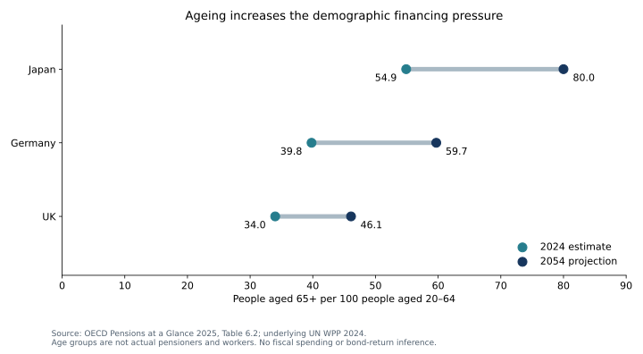

# Ageing and fiscal pressure: policy mediates the demographic arithmetic

**21 October 2026 · Public demographic and pension projections; hypothetical policy sensitivities · Sovereign valuation: NEEDS_DATA.**

**Conclusion:** ageing puts pressure on financing, but the age ratio alone cannot determine pension spending, deficits or bond returns. For Japan, Germany and the UK, OECD demographic projections imply a 35.6–50.0% rise in the 65+/20–64 ratio by 2054. Separately, published pension projections show much smaller percentage-point changes in spending relative to GDP. Different horizons, policy assumptions and methods prevent interpreting the difference as a measured reform benefit.

## Evidence and independent contribution

[OECD Pensions at a Glance 2025, Table 6.2](https://www.oecd.org/en/publications/2025/11/pensions-at-a-glance-2025_76510fe4/full-report/demographic-old-age-to-working-age-ratio_25476b96.html) uses UN World Population Prospects 2024. People aged 65+ per 100 people aged 20–64 rise from 54.9 to 80.0 in Japan, 39.8 to 59.7 in Germany and 34.0 to 46.1 in the UK between 2024 and 2054. These are age groups, **not actual pension claimants and employed contributors**.

[Table 8.4](https://www.oecd.org/en/publications/pensions-at-a-glance-2025_e40274c1-en/full-report/long-term-projections-of-public-pension-expenditure_af4ed734.html) separately reports public-pension spending of 9.1% to 9.3% of GDP for Japan, 10.2% to 11.0% for Germany and 7.6% to 8.5% for the UK from the 2023/24 base to 2050. These are policy-conditional projections assembled from different national model vintages, not a uniform unconditional forecast. [Register and locators](sources.json).

The original contribution is to separate the demographic ratio, published fiscal projections and a transparent policy identity. The research reading supplied analytical prompts; it did not supply the model inputs or sovereign conclusions.

## A bounded policy experiment

Assume every person aged 65+ receives a common benefit, 75% of the 20–64 population works, and the benefit is 30% of baseline output per worker. With the age ratio expressed per 100, the illustrative benefit burden as a percentage of output equals **age ratio × benefit/output-per-worker / employment fraction**. This deliberately simplified identity is not national pension spending or total public expenditure.

For Japan's projected ratio of 80, the hypothetical burden is 32% of output. Raising employment from 75% to 80% reduces it to 30%. A 10% productivity level gain reduces it to 29.09% **only if real benefits remain fixed**; if benefits rise proportionally with productivity, it stays 32%. Reducing the benefit ratio from 30% to 27% lowers it to 28.8%, while creating adequacy/distributional trade-offs. [All country results](RESULTS.md) · [Inputs](inputs.json) · [Model](model.py).

This tests mechanisms, not political feasibility. Employment, retirement eligibility, migration, health and skills are not independent frictionless levers. Later retirement or lower benefits can shift burdens onto vulnerable households; participation measures also require costs and capacity.

## Contrary case and investment boundary

Higher employment, well-designed policy, productivity and tax capacity could offset pressure. Healthcare, long-term care, weak growth and interest costs could amplify it. A larger age ratio does not establish the timing, currency or size of a sovereign spread move.

**NEEDS_DATA:** current country-specific coverage and benefit/indexation rules; employment by age; migration and retirement scenarios; health/long-term-care costs; fiscal reaction; debt maturity, currency and interest-rate paths; and security-level market expectations. Next reconcile the official models' assumptions before integrating pensions into a fiscal/debt model. The 2054 demographic and 2050 fiscal series are deliberately not merged into a causal residual. No trade, debt sustainability certification, research approval or independent human validation is claimed.

## Reproduce

From the root: `python examples/ageing-fiscal/model.py --check` (Python 3.10+, standard library, offline). Optional chart: `python examples/render_public_case_charts.py` with Matplotlib installed. Model `--write` deliberately regenerates outputs; retain this source vintage in any later comparison.
